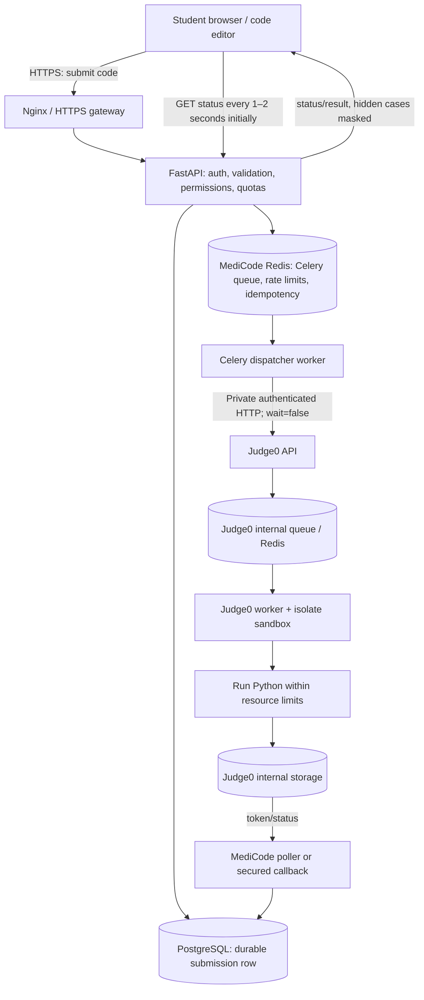

# MediCode — Python Code Execution, Docker, Redis, Judge0 & Security Guide

**Purpose:** Practical implementation pathway for the first production-oriented Python runner in MediCode  
**Prepared:** 18 October 2026  
**Based on:** `MEDICODE_BACKEND_ARCHITECTURE.md`, `API_ROUTES_AND_ENDPOINTS.md`, and `USER WISE DISTRIBUTION.md` supplied for MediCode.  
**Scope:** Python first; FastAPI control plane; PostgreSQL source of truth; Redis/Celery for asynchronous orchestration and rate control; Judge0 as the execution engine.

> **Core recommendation:** Do not build a custom code-execution engine from scratch for the first version. Build MediCode's submission, authorization, grading and result workflow around a self-hosted Judge0 Community Edition (CE) instance, reachable only over a private network. Judge0 runs the untrusted Python code inside its sandbox. Add a MediCode `SandboxRunner` interface so the engine can later be changed to gVisor, nsjail or another maintained runner without rewriting your APIs.

---

## Contents

1. [Decisions at a glance](#1-decisions-at-a-glance)
2. [Architecture and full request flow](#2-architecture-and-full-request-flow)
3. [Docker, sandbox and Judge0: what each does](#3-docker-sandbox-and-judge0-what-each-does)
4. [Redis and queue management](#4-redis-and-queue-management)
5. [Security and what can/cannot be prevented](#5-security-and-what-cancannot-be-prevented)
6. [Encryption: data in transit, at rest and during execution](#6-encryption-data-in-transit-at-rest-and-during-execution)
7. [Efficient Python grading workflow](#7-efficient-python-grading-workflow)
8. [API design and result contract](#8-api-design-and-result-contract)
9. [Starter implementation](#9-starter-implementation)
10. [Docker Compose for the MediCode control plane](#10-docker-compose-for-the-medicode-control-plane)
11. [Judge0 deployment and configuration](#11-judge0-deployment-and-configuration)
12. [Scaling simultaneous students without wasting money](#12-scaling-simultaneous-students-without-wasting-money)
13. [Cost-control plan](#13-cost-control-plan)
14. [Testing, abuse tests and release checklist](#14-testing-abuse-tests-and-release-checklist)
15. [Phased roadmap](#15-phased-roadmap)
16. [Official references](#16-official-references)

---

## 1. Decisions at a glance

| Decision | Recommended starting point | Why |
|---|---|---|
| API | FastAPI, one modular backend | Simple to build and inexpensive to operate at first |
| Durable submission/result records | PostgreSQL | Redis must not be the only copy of a submission |
| App-level background jobs | Celery + a dedicated MediCode Redis | API returns immediately; workers process jobs independently |
| Code execution engine | Self-host Judge0 CE | Avoid reinventing language runtimes, timeouts and sandbox management |
| Isolation | Judge0's sandbox, no network for student programs, strict CPU/memory/process/output/time limits | Student code is untrusted and can deliberately consume resources |
| Student-facing endpoints | `POST /api/v1/submissions/run`, `POST /api/v1/submissions`, `GET /api/v1/submissions/{id}` | Separate quick-run from scored submission, with a shared internal pipeline |
| Queue item contents | Submission ID only | Do not copy full code or test data into queue messages |
| Hidden tests | Load from the database/storage in the worker; never serialize them to student responses | Prevent hidden input/output leakage |
| TLS | HTTPS from browser to API; TLS/mTLS or private encrypted transport between services when crossing hosts | Encrypt network traffic and authenticate internal services |
| At-rest protection | Encrypted database volumes/backups; secret manager for credentials; optional field-level encryption for sensitive data | Limits exposure from lost disks/backups and leaked credentials |
| Starting infrastructure | A small API/database/Redis node plus a separate runner node when production-grade isolation is needed | Keeps the risky execution environment away from the public API |
| Autoscaling | Scale runner workers based on queue age/depth and measured CPU/memory; scale back down off-peak | Avoid paying for idle capacity while protecting the API during bursts |

### The economical decision

There are two valid ways to start:

**Option A — simplest MVP:** FastAPI stores a submission in PostgreSQL and sends it straight to the private Judge0 API with `wait=false`. Judge0 manages its execution queue. Redis is initially used for throttling, idempotency and short-lived status/cache keys. Add Celery when MediCode needs explicit admission control, retries, prioritisation and other background tasks.

**Option B — recommended for the MediCode architecture in your documents:** FastAPI stores the submission and places its ID on a Celery/Redis queue. A dispatcher worker forwards it to Judge0's private API. Judge0 then places the execution in its own internal queue. A MediCode result worker/poller records the final result in PostgreSQL. This is technically a two-stage queue, but the stages have different jobs: MediCode controls product policy and backpressure; Judge0 schedules execution. Start with a small worker count and measure it.

**Avoid a third queue or microservice just for the sake of it.** Do not introduce Kubernetes, Kafka, a service mesh, or a custom container pool for the first Python-only release.

---

## 2. Architecture and full request flow



### Step-by-step flow

1. **The user presses Submit.** The browser sends the source code and a request identifier over HTTPS. It never receives direct access to Judge0.
2. **The API authenticates and authorizes.** Verify the session/token, tenant, enrolled course, problem visibility, exam window if relevant, and permission (`code:run` or `lab:submit`). Do not trust role or student ID values supplied in the JSON body.
3. **Validate limits before scheduling.** Python-only language allowlist, code-size limit (e.g. 64 KB), stdin limit for quick runs, maximum test-case count, rate limits, and account/tenant quota. Reject oversized payloads before they consume queue or runner capacity.
4. **Persist first.** Insert a durable PostgreSQL row with `status='pending'`, the authenticated user/tenant, code, problem ID if present, and idempotency key. The database is the record of truth.
5. **Enqueue only the ID.** Put `submission_id` on the Redis-backed Celery queue. Do not put raw source code, passwords or hidden test cases in the Celery message.
6. **Return promptly.** Return HTTP `202 Accepted` with the MediCode submission ID. Do not hold the browser's HTTP request open until Python finishes.
7. **Dispatch to Judge0.** A worker loads code and allowed parameters from PostgreSQL, calls Judge0's submission endpoint with `wait=false`, and saves Judge0's token against the MediCode record.
8. **Wait asynchronously.** Prefer a supported, authenticated callback after you have validated its security. For the first MVP, a Celery task can poll the Judge0 token at a modest interval and reschedule itself with a delay, rather than blocking a worker with `sleep()`.
9. **Store result.** Save status, capped stdout/stderr, runtime and memory. For scored submissions, compare each run with server-held test cases and calculate the score in a transaction.
10. **The browser fetches the result.** It calls MediCode's `GET /submissions/{id}`. Check ownership/object permissions for every result request. Return a result DTO, not the raw database row.
11. **Clean and audit.** Set retention rules for source code and outputs; redact code and secrets from logs; keep security/audit events and operational metrics.

### Important reliability pattern: database first, queue second

If PostgreSQL saves a submission but Redis is temporarily unavailable, the record still exists. Add a small **outbox/sweeper** process that finds `pending` submissions not yet dispatched and re-enqueues them. This prevents a queue outage from silently losing submissions. Mark tasks idempotently so a retry updates the same submission rather than creating a second grade/result row.

---

## 3. Docker, sandbox and Judge0: what each does

These are related but different layers:

- **Docker** packages and runs trusted service containers, such as FastAPI, Redis and PostgreSQL. Docker also provides namespaces/cgroups and other controls, but a normal container still shares the host kernel.
- **Sandbox** is the security boundary around the untrusted program. It restricts files, network, syscalls, CPU, memory, process count, time and output. Do not treat Python's `exec()`, AST filtering, or a normal `subprocess` call as a secure sandbox.
- **Judge0** is the code-execution service that accepts source code, a language ID and optional stdin/resource limits, then returns a token and later a result. Its current CE API documents sandboxed execution, configurable resource limits and the asynchronous submission-token flow. Judge0 CE uses `isolate` for sandboxing; read its configuration and upstream deployment instructions rather than replacing its isolation commands casually. [Judge0 API docs](https://ce.judge0.com/) · [Judge0 repository](https://github.com/judge0/judge0) · [Judge0 configuration](https://github.com/judge0/judge0/blob/master/judge0.conf)

### Why use Judge0 first?

A custom runner means your team must safely create/destroy execution environments, enforce hard limits, handle timeouts and output floods, clean files, handle process trees, patch runtimes, and test sandbox escape protections. Those are security-critical operating-system problems. For MediCode, the learning product (labs, grading rules, faculty tools, OBE and results) is the differentiator; Judge0 lets the team focus on that product while providing a replaceable execution adapter.

### Keep a small MediCode interface around it

Do not scatter Judge0 HTTP calls through your endpoints. Build one adapter such as:

```python
class SandboxRunner:
    def submit_python(self, *, source_code: str, stdin: str,
                      cpu_limit_s: float, wall_limit_s: float,
                      memory_limit_kb: int) -> str:
        """Send code to the runner and return its opaque runner token."""
        raise NotImplementedError

    def get_result(self, runner_token: str) -> dict:
        """Fetch and normalize one runner result."""
        raise NotImplementedError
```

The production implementation can be `Judge0Runner`. Later, a different runner can implement the same contract.

### Sandbox baseline

Use these as **initial policy values**, then tune with tests on the selected Judge0 version and actual workload. These are not a guarantee against every vulnerability.

| Limit | Starting policy for basic Python labs | Notes |
|---|---:|---|
| CPU time | 1 second | Some algorithm problems need more; set per-problem upper bounds on the server |
| Wall clock | 3 seconds | Hard upper bound catches sleep/wait cases; longer only for explicitly approved problems |
| Memory | 128 MiB (`131072` KiB in Judge0 fields) | Increase only where the problem requires it; keep a platform maximum |
| Processes/threads | 16–32 | Prevent resource abuse; confirm permitted values in the deployed Judge0 configuration |
| Output | 64–512 KiB maximum for stdout/stderr, depending on feature | Truncate and flag output-limit cases; do not allow huge payloads into PostgreSQL or the browser |
| Source size | 64 KiB | Increase only when needed for multi-file projects |
| Filesystem | Sandbox-only workspace; no host mounts containing secrets | Never mount the host root, Docker socket, database files or application secrets |
| Network | Disabled for student code | Judge0 itself may need infrastructure access; the student's program must not inherit that permission |
| Process cleanup | Kill the entire sandbox/job on timeout; remove temporary workspace | Do not reuse mutable program state between students |

The uploaded backend specification proposes Python-only in Phase 3, a 2-second wall clock as a general default, 128 MiB default memory, no network, capped output, and hard sandbox cleanup. Those principles are appropriate; use one centrally configured profile per problem/runtime, with server-enforced maximums.

### Security warning about Docker and Judge0 deployment

The upstream Judge0 Docker Compose file currently uses `privileged: true` for the Judge0 server/worker services. This is a consequential privilege choice, not a setting to copy blindly. Read the [official Compose file](https://github.com/judge0/judge0/blob/master/docker-compose.yml) and upstream deployment guidance for the exact pinned release. **For production, put Judge0 on a dedicated runner VM/host or another strongly separated execution boundary**, firewall it from the public internet, and permit requests only from MediCode's service identity/network. Do not co-locate the public FastAPI app and a privileged execution service on one host if you can avoid it. A small isolated runner node is usually a better security trade-off than trying to make an untrusted execution engine share the API host.

Also never give the MediCode API container the Docker socket (`/var/run/docker.sock`). A service able to control the host Docker daemon may effectively control the host. See [Docker Engine security](https://docs.docker.com/engine/security/).

---

## 4. Redis and queue management

Redis is useful because it is fast at short-lived counters, locks, queues and status signals. It must not be the only durable store for submission source code, grades or final results.

### Recommended Redis uses

| Key / function | Example | Why it exists | Durable record? |
|---|---|---|---|
| Celery task queue | Celery queue `execution_jobs` | Queue IDs for the dispatcher and background tasks | No; PostgreSQL + outbox/sweeper is authoritative |
| Submission rate limit | `rl:submit:{user_id}:{minute}` | Limit burst traffic per account | No |
| Short duplicate-submit lock | `lock:submit:{user_id}` with short TTL | Stop rapid double-clicks | No |
| Idempotency lookup | `idem:{user_id}:{idempotency_key}` | Return the same MediCode submission for a repeated client request | PostgreSQL unique constraint is the final guard |
| Worker lock | `lock:grade:{submission_id}` using `SET NX EX` | Reduce two workers grading the same item simultaneously | No; database writes still need idempotency |
| Cached status | `substatus:{submission_id}` (short TTL) | Reduce repeated database reads if measured load justifies it | No; rebuild from PostgreSQL |
| Live events | Pub/Sub channel by user/submission | Tell WebSocket/API instance that a result changed | No; clients can recover by GET status |

### How the queue helps during exam-time spikes

Suppose 300 students press Submit around the same minute. The API should validate and write rows quickly; it should not start 300 Python programs itself. The queue absorbs the burst. The dispatcher sends work only as quickly as the runner can safely accept it. Excess work waits as `pending` instead of exhausting API CPU or RAM.

Set a maximum queue age and queue length. When capacity is exhausted, return a clear response such as `429 Too Many Requests` or `503 Runner Busy` with `Retry-After`, rather than accepting unlimited work and allowing the service to collapse. Do not promise immediate execution if the queue is backed up.

### Redis configuration rules

- Use a strong password or ACL and a private network. Do not publish port `6379` to the public internet.
- Enable persistence appropriate to the queue's role (for example AOF) and have a recovery plan. Persistence is a safety net, not a substitute for PostgreSQL/outbox recovery.
- Keep the queue broker away from arbitrary public clients. Prefer a dedicated MediCode Redis. Judge0 also has its own Redis configuration: do **not** casually share one Redis instance and credentials with a privileged runner service.
- If Redis is out of memory, broker messages must not be silently evicted. Configure broker memory policy deliberately (`noeviction` is a common queue-broker choice) and monitor memory. Keep cache keys and high-churn metrics elsewhere or keep them bounded.
- Use TTLs for locks and counters; never rely on a lock without expiry.
- Celery tasks should be idempotent. A task may execute again after worker failure or broker redelivery. [Celery task guide](https://docs.celeryq.dev/en/stable/userguide/tasks.html) · [Celery Redis caveats](https://docs.celeryq.dev/en/stable/getting-started/backends-and-brokers/redis.html)

### Don't make one huge Redis message

Prefer:

```json
{"submission_id":"a durable UUID"}
```

Avoid putting this in a queue message:

```json
{"source_code":"...full student program...","hidden_tests":"...","access_token":"..."}
```

The worker fetches the source from PostgreSQL using the ID. This keeps queue messages small and reduces the number of places where code and sensitive data are copied.

---

## 5. Security and what can/cannot be prevented

### 5.1 Protect the execution boundary

1. Only MediCode backend services can reach Judge0. Do not expose the Judge0 port to browsers or the general public.
2. Enable Judge0 authentication/authorization if supported by the selected deployment; keep tokens in a secret store/environment, never in frontend code or URLs. Rotate them.
3. Use the least privileged service identity and private networking. If the connection crosses machines, use TLS; consider mTLS so the runner verifies which service is calling it.
4. Enforce limits on the server side, not in the React frontend and not solely from user-provided JSON.
5. Disable network access for submitted programs. If the problem requires external access, create a separate explicitly approved policy instead of changing the global default.
6. Do not pass through `compiler_options`, command-line arguments, custom images, filesystem paths, network flags or arbitrary runner configuration from the student. These must be server-allowlisted.
7. Keep sandbox images and host OS patched. Pin the Judge0 image to a tested version/digest instead of pulling `latest` during production rollout.
8. Do not mount application secrets, `.env`, database sockets, cloud credentials or the Docker socket into a runner sandbox.
9. Kill the entire process tree/job on timeout. Cap stdout, stderr, file sizes, memory, CPU, PID count and wall clock.
10. Treat stdout/stderr as untrusted text. Escape it before rendering in the browser; never render output as HTML.

### 5.2 Prevent frontend/API bypasses

The browser is not a trust boundary. Students can modify JavaScript, send their own HTTP calls, replay a request or bypass frontend validations. Therefore:

- Enforce authentication, roles, tenant, problem access and ownership on every API route.
- Fetch user/tenant identity from a verified access token; don't accept `student_id`, `score`, `passed`, `role` or `tenant_id` from the client as authoritative.
- Scores and verdicts are written only by the backend worker.
- Use a unique `Idempotency-Key` for submissions plus a database uniqueness rule such as `(user_id, idempotency_key)`.
- Rate-limit at several levels: IP at Nginx, account/user in Redis, per-tenant quotas, and global runner admission.
- Put maximums on source length, stdin length, requests per minute, queued jobs per user, and daily/monthly execution count.
- Do not expose hidden test inputs/expected outputs, full Judge0 payloads, internal stack traces or internal service URLs.
- For hidden-test results return only safe information, such as `Wrong Answer` and aggregate score. Do not return hidden input, expected output, or precise per-hidden-case timings/memory if that could support probing.
- Give one user access only to their own submissions, unless a faculty permission specifically allows viewing a section's submissions.
- Keep audit logs for repeated probing, rate-limit hits, queue abuse, failed auth, cross-tenant access denials and administrative overrides.

### 5.3 What “cannot bypass” really means

No online execution sandbox can honestly promise that bypass is impossible forever. Container/runtime/kernel vulnerabilities can exist. The engineering objective is to make bypass difficult, reduce the blast radius, detect abuse, patch quickly, and prevent a student from obtaining host/API/database access even if a program behaves maliciously.

The following do **not** secure untrusted code by themselves:

- Hiding the browser's DevTools or blocking right-click.
- Obfuscating API routes.
- Checking code with regex/AST alone.
- Calling Python `exec()` or `eval()` in the API process.
- Running a student program inside the same container as FastAPI.
- Disabling network only from the frontend.

Docker's default seccomp profile is useful defence in depth, but is not equivalent to a separate virtual machine. See [Docker seccomp documentation](https://docs.docker.com/engine/security/seccomp/) and [Docker Engine security](https://docs.docker.com/engine/security/).

---

## 6. Encryption: data in transit, at rest and during execution

The requirement “data comes and goes encrypted” needs to be interpreted carefully because code must be readable to run it.

### In transit

- Browser → gateway → API: HTTPS/TLS 1.2+ (prefer modern TLS configuration).
- API/worker → Judge0: TLS if crossing hosts; for private same-host networking at minimum use a private isolated network with strict access controls. Prefer TLS/mTLS where operationally practical.
- API/worker → PostgreSQL and Redis: private network; enable TLS when crossing hosts or networks not fully trusted. Use separate credentials/ACLs.
- Never send access tokens or service keys as URL query parameters. Use authorization headers or a secure service identity.

### At rest

- Use encrypted persistent disks/volumes and encrypted backups for PostgreSQL, Redis data if persisted, and any object storage.
- Store secrets in a secret manager or protected environment file with strict OS permissions. Keep `.env` out of Git.
- For especially sensitive fields, consider application-level AES-256-GCM envelope encryption with a KMS-managed key. Key rotation, access policy and recovery need to be designed; do not implement homemade cryptography.
- Hash passwords with Argon2id or bcrypt; passwords are not encrypted/decrypted.
- Keep logs free of complete source code, authentication credentials, raw hidden tests and unnecessary personal information.

### During execution

Judge0 must receive program source in a form it can execute. That means plaintext exists at least in the trusted API/worker memory and in the isolated runner's execution workspace at some point. Ordinary TLS and disk encryption do **not** protect data from the authorised process while it is executing. Minimize copies, restrict access, clean temporary files and limit retention. Do not promise end-to-end encryption that prevents the runner from reading code while also asking the runner to execute it.

### Practical data path

```text
Browser --HTTPS--> MediCode API
                       |
                       | save source code to encrypted PostgreSQL volume
                       v
                 PostgreSQL (source of truth)
                       |
                       | Celery message contains submission_id only
                       v
                 MediCode worker --private TLS/mTLS--> Judge0
                                                       |
                                                       v
                                                Isolated sandbox
                                                       |
                 PostgreSQL <--- normalized result ---+
                       |
Browser --HTTPS--> GET /submissions/{id}
```

---

## 7. Efficient Python grading workflow

Keep “Run” and “Submit for grading” as two product actions, even if they share code internally.

### A. Run / dry-run

- Student supplies code and custom stdin.
- No hidden cases; normally no grade is recorded.
- One Judge0 execution.
- Return stdout, stderr, exit status, runtime and memory subject to size limits.
- Apply tighter per-user limits, because repeated custom runs are expensive.

### B. Submit / graded run

- Student submits code for a specific problem.
- Backend retrieves the test cases and scoring policy. Client cannot choose hidden cases or expected outputs.
- For each test case, the worker runs the same source code with that case's stdin. For simple problems this may mean one execution per case; use Judge0's batch endpoint where it fits the installed version and reduce network round trips.
- The backend compares output using the problem's allowed checker (`exact`, normalized tokens, or numeric tolerance) and calculates score from server-side weights.
- Persist per-case result rows and final score in one transaction.
- Return detailed results for visible cases, only a masked verdict for hidden cases.

### Output normalization

Decide per problem whether trailing whitespace, line endings or token whitespace are ignored. Do not make every test use an overly permissive comparator. For floating-point tasks, use an explicit absolute/relative tolerance; for custom checkers, execute the checker in a sandbox with equally strict limits.

### Status lifecycle

Use a small state machine, and make transitions explicit:

`pending → dispatching → queued → running → completed`

Also allow terminal states such as `rejected`, `failed`, `cancelled`, `timeout` or `internal_error`. Avoid a generic status that hides whether the failure is a student's code error or an infrastructure incident.

### Verdicts to expose

| Internal event | Student-facing label |
|---|---|
| Output matches expected result | Accepted (AC) |
| Output doesn't match | Wrong Answer (WA) |
| CPU/wall limit exceeded | Time Limit Exceeded (TLE) |
| Runtime memory limit exceeded | Memory Limit Exceeded (MLE) |
| Unhandled exception/non-zero exit | Runtime Error (RE) |
| Output cap exceeded | Output Limit Exceeded (OLE) |
| Runner/system problem | Internal Error / Retry available |

For Python, there is no traditional compile step in the same way as C/C++; syntax errors appear when Python starts and should be translated into a useful runtime/program error. Keep raw internal runner messages out of public API responses.

---

## 8. API design and result contract

Your API-route draft has `/submissions/dry-run`, `/submissions/test` and `/submissions/final`. Your backend specification also defines a canonical `POST /submissions` plus `GET /submissions/{id}`. To avoid three different execution pipelines, normalize them as **three public operations backed by one internal submission service**:

| Route | Purpose | Graded? | Test data |
|---|---|---:|---|
| `POST /api/v1/submissions/run` | Run against custom stdin | No | User's own stdin; no hidden tests |
| `POST /api/v1/submissions/test` | Try visible/sample test cases | No | Visible cases only |
| `POST /api/v1/submissions` | Final graded submission | Yes | Backend-owned visible + hidden tests |
| `GET /api/v1/submissions/{submission_id}` | Get status/result if authorized | — | Hidden case data always masked |

The API should immediately return a MediCode ID (not a Judge0 token). Keep Judge0 tokens internal.

### Request: quick run

```http
POST /api/v1/submissions/run
Authorization: Bearer <access-token>
Idempotency-Key: 8016bb9f-e5bc-4fdc-96e8-67aee5df2db8
Content-Type: application/json
```

```json
{
  "language": "python",
  "code": "name = input()\nprint(f'Hello, {name}!')",
  "stdin": "MediCode\n"
}
```

### Immediate response

```json
{
  "submission_id": "a durable UUID",
  "status": "pending",
  "poll_url": "/api/v1/submissions/a-durable-uuid"
}
```

Use HTTP `202 Accepted`. The example UUID above is illustrative.

### Completed response (quick run)

```json
{
  "submission_id": "a-durable-uuid",
  "status": "completed",
  "verdict": "FINISHED",
  "stdout": "Hello, MediCode!\n",
  "stderr": "",
  "runtime_ms": 24,
  "memory_kb": 8200
}
```

Values are illustrative, not a performance guarantee.

### Safe request schema

The student may submit only fields that they are allowed to control. Never accept a student-provided `score`, `status`, `hidden`, `expected_output`, `time_limit`, `memory_limit`, `enable_network`, Judge0 `language_id`, or arbitrary runner flags. Map the language alias `python` to the pinned Python language ID configured on the server. The Judge0 language catalogue can change between releases, so query `/languages` during setup and pin/verify the correct language ID instead of assuming an ID is universal. [Judge0 languages and submissions API](https://ce.judge0.com/)

---

## 9. Starter implementation

This is a **starter skeleton** for the control-plane integration, not a complete hardened production deployment. It demonstrates the key boundaries and the asynchronous sequence. Plug it into MediCode's existing verified authentication, tenant-scoping, SQLAlchemy migrations, logging and permission dependencies before exposing it to students.

### 9.1 Suggested file layout

```text
medicode-backend/
├── app/
│   ├── main.py
│   ├── config.py
│   ├── db.py
│   ├── models.py
│   ├── schemas.py
│   ├── auth.py                 # existing verified JWT/session dependency
│   ├── routers/
│   │   └── submissions.py
│   ├── services/
│   │   └── judge0_client.py
│   └── tasks.py                # Celery tasks: dispatch + poll
├── requirements.txt
├── Dockerfile
├── docker-compose.yml
└── .env                         # local only; never commit
```

### 9.2 Install dependencies

`requirements.txt`:

```text
fastapi>=0.115,<1.0
uvicorn[standard]>=0.30,<1.0
pydantic-settings>=2.4,<3.0
SQLAlchemy>=2.0,<3.0
psycopg[binary]>=3.2,<4.0
redis>=5.0,<7.0
celery[redis]>=5.4,<6.0
httpx>=0.27,<1.0
```

Pin and lock exact tested versions before production. Run dependency and image scanning in CI.

### 9.3 Configuration

`app/config.py`:

```python
from pydantic_settings import BaseSettings, SettingsConfigDict


class Settings(BaseSettings):
    # Require real values through environment variables / secrets in deployment.
    database_url: str
    redis_url: str
    judge0_base_url: str
    judge0_python_language_id: int
    judge0_auth_token: str | None = None

    # Keep these as central policy settings; don't accept arbitrary values from students.
    max_source_bytes: int = 65536
    max_stdin_bytes: int = 65536
    cpu_time_limit_s: float = 1.0
    wall_time_limit_s: float = 3.0
    memory_limit_kb: int = 131072
    output_limit_bytes: int = 131072

    model_config = SettingsConfigDict(
        env_file=None,  # Compose/environment/secret manager provides settings.
        case_sensitive=False,
        extra="ignore",
    )


settings = Settings()
```

A local `.env` can be loaded by Compose; do not load development defaults in production. If Judge0 authentication is enabled, configure the correct header name as per your chosen deployment, not an assumed token convention.

### 9.4 Database connection and model

`app/db.py`:

```python
from sqlalchemy import create_engine
from sqlalchemy.orm import DeclarativeBase, sessionmaker
from app.config import settings

engine = create_engine(
    settings.database_url,
    pool_pre_ping=True,
    pool_size=5,
    max_overflow=5,
)
SessionLocal = sessionmaker(bind=engine, autoflush=False, autocommit=False)


class Base(DeclarativeBase):
    pass


def get_db():
    db = SessionLocal()
    try:
        yield db
    finally:
        db.close()
```

`app/models.py`:

```python
import uuid
from datetime import datetime, timezone
from sqlalchemy import DateTime, Integer, String, Text, UniqueConstraint
from sqlalchemy.orm import Mapped, mapped_column
from app.db import Base


class Submission(Base):
    __tablename__ = "submissions"
    __table_args__ = (
        UniqueConstraint("user_id", "idempotency_key", name="uq_submit_user_idem"),
    )

    id: Mapped[str] = mapped_column(String(36), primary_key=True, default=lambda: str(uuid.uuid4()))
    tenant_id: Mapped[str] = mapped_column(String(36), index=True)
    user_id: Mapped[str] = mapped_column(String(36), index=True)
    idempotency_key: Mapped[str] = mapped_column(String(80))
    language: Mapped[str] = mapped_column(String(20), default="python")
    mode: Mapped[str] = mapped_column(String(20), default="run")
    source_code: Mapped[str] = mapped_column(Text)
    stdin: Mapped[str] = mapped_column(Text, default="")
    status: Mapped[str] = mapped_column(String(24), default="pending", index=True)
    judge0_token: Mapped[str | None] = mapped_column(String(80), nullable=True, index=True)
    verdict: Mapped[str | None] = mapped_column(String(80), nullable=True)
    stdout: Mapped[str | None] = mapped_column(Text, nullable=True)
    stderr: Mapped[str | None] = mapped_column(Text, nullable=True)
    runtime_ms: Mapped[int | None] = mapped_column(Integer, nullable=True)
    memory_kb: Mapped[int | None] = mapped_column(Integer, nullable=True)
    created_at: Mapped[datetime] = mapped_column(
        DateTime(timezone=True), default=lambda: datetime.now(timezone.utc)
    )
```

**Production notes:** use PostgreSQL UUID types/foreign keys and Alembic migrations, add `problem_id`, exam/session fields and result tables for graded submissions, and enable tenant isolation/RLS from your main architecture. This minimal model stores code in PostgreSQL for demonstration; define retention/deletion policy and encrypted storage before production. A unique key at the database layer protects against race conditions that Redis alone cannot fully prevent.

### 9.5 Request/response schema

`app/schemas.py`:

```python
from pydantic import BaseModel, Field, ConfigDict


class RunRequest(BaseModel):
    model_config = ConfigDict(extra="forbid")
    language: str = Field(default="python", pattern="^python$")
    code: str = Field(min_length=1, max_length=65536)
    stdin: str = Field(default="", max_length=65536)


class SubmissionAccepted(BaseModel):
    submission_id: str
    status: str
    poll_url: str
```

Pydantic character limits are not byte limits. Check encoded UTF-8 byte size in the route as well.

### 9.6 Judge0 client

`app/services/judge0_client.py`:

```python
import httpx
from app.config import settings


def _headers() -> dict[str, str]:
    headers = {"Content-Type": "application/json"}
    if settings.judge0_auth_token:
        # Header name may be configurable on your Judge0 deployment.
        headers["X-Auth-Token"] = settings.judge0_auth_token
    return headers


def create_judge0_submission(source_code: str, stdin: str) -> str:
    """Create an asynchronous Judge0 run and return its opaque token."""
    payload = {
        "source_code": source_code,
        "language_id": settings.judge0_python_language_id,
        "stdin": stdin,
        "cpu_time_limit": settings.cpu_time_limit_s,
        "wall_time_limit": settings.wall_time_limit_s,
        "memory_limit": settings.memory_limit_kb,  # Judge0 uses KB for this field.
        "max_processes_and_or_threads": 32,
        "enable_network": False,
        "number_of_runs": 1,
    }

    # Do not set wait=true: create quickly, then get status asynchronously.
    with httpx.Client(timeout=httpx.Timeout(5.0, connect=2.0)) as client:
        response = client.post(
            f"{settings.judge0_base_url.rstrip('/')}/submissions?base64_encoded=false&wait=false",
            json=payload,
            headers=_headers(),
        )
        response.raise_for_status()
        data = response.json()

    token = data.get("token")
    if not token:
        raise RuntimeError("Judge0 did not return a submission token")
    return token


def get_judge0_result(token: str) -> dict:
    with httpx.Client(timeout=httpx.Timeout(5.0, connect=2.0)) as client:
        response = client.get(
            f"{settings.judge0_base_url.rstrip('/')}/submissions/{token}",
            params={
                "base64_encoded": "false",
                "fields": "token,status,stdout,stderr,compile_output,message,exit_code,time,wall_time,memory",
            },
            headers=_headers(),
        )
        response.raise_for_status()
        return response.json()
```

The example is written for a Judge0 deployment using `X-Auth-Token`. Configure the actual header names and auth behavior for the pinned instance; do not turn off network isolation just because a test fails. Judge0 documents the asynchronous token workflow and says `wait=true` is not recommended for scalable submission handling. [Official API documentation](https://ce.judge0.com/)

### 9.7 Celery app and tasks

`app/tasks.py`:

```python
import httpx
from celery import Celery
from sqlalchemy import select
from app.config import settings
from app.db import SessionLocal
from app.models import Submission
from app.services.judge0_client import create_judge0_submission, get_judge0_result

celery_app = Celery("medicode", broker=settings.redis_url)
celery_app.conf.update(
    task_acks_late=True,
    worker_prefetch_multiplier=1,
    task_reject_on_worker_lost=True,
    broker_connection_retry_on_startup=True,
    task_serializer="json",
    accept_content=["json"],
    result_serializer="json",
    task_track_started=True,
)

# Judge0 statuses 1 and 2 mean queued/processing in its standard status catalogue.
PENDING_JUDGE0_STATUS_IDS = {1, 2}
POLL_DELAYS_SECONDS = (1, 2, 3, 5, 5, 5)


@celery_app.task(bind=True, max_retries=3, name="medicode.dispatch_submission")
def dispatch_submission(self, submission_id: str):
    """Queue item contains an ID only; source code is loaded from PostgreSQL."""
    with SessionLocal() as db:
        sub = db.get(Submission, submission_id)
        if not sub or sub.status in {"completed", "rejected", "failed"}:
            return
        # Idempotency guard: don't send an already-dispatched row again in normal retries.
        if sub.judge0_token:
            poll_submission.apply_async(args=[sub.id, 0], countdown=1)
            return
        sub.status = "dispatching"
        db.commit()
        source_code, stdin = sub.source_code, sub.stdin

    try:
        token = create_judge0_submission(source_code, stdin)
    except (httpx.ConnectError, httpx.ConnectTimeout) as exc:
        # Connection was not established; a bounded retry is reasonable.
        raise self.retry(exc=exc, countdown=min(2 ** self.request.retries, 10))
    except httpx.TimeoutException:
        # A read/write timeout may mean Judge0 accepted the job but the response was lost.
        # Don't blindly POST again: that can execute the same source twice. Reconcile this
        # state or use an authenticated callback before deciding to dispatch again.
        with SessionLocal() as db:
            sub = db.get(Submission, submission_id)
            if sub:
                sub.status = "dispatch_unknown"
                db.commit()
        return
    except httpx.HTTPStatusError as exc:
        if exc.response.status_code in {429, 500, 502, 503, 504}:
            raise self.retry(exc=exc, countdown=min(2 ** self.request.retries, 10))
        with SessionLocal() as db:
            sub = db.get(Submission, submission_id)
            if sub:
                sub.status = "failed"
                sub.verdict = "RUNNER_REJECTED_REQUEST"
                db.commit()
        return

    with SessionLocal() as db:
        sub = db.get(Submission, submission_id)
        if sub:
            sub.judge0_token = token
            sub.status = "queued"
            db.commit()

    poll_submission.apply_async(args=[submission_id, 0], countdown=1)


@celery_app.task(name="medicode.poll_submission", max_retries=6)
def poll_submission(submission_id: str, attempt: int = 0):
    with SessionLocal() as db:
        sub = db.get(Submission, submission_id)
        if not sub or not sub.judge0_token or sub.status in {"completed", "rejected", "failed"}:
            return
        token = sub.judge0_token

    data = get_judge0_result(token)
    status_info = data.get("status") or {}
    status_id = status_info.get("id")

    if status_id in PENDING_JUDGE0_STATUS_IDS:
        next_attempt = attempt + 1
        if next_attempt >= len(POLL_DELAYS_SECONDS):
            # Reschedule at the capped interval instead of occupying a worker with sleep().
            next_attempt = len(POLL_DELAYS_SECONDS) - 1
        poll_submission.apply_async(
            args=[submission_id, next_attempt],
            countdown=POLL_DELAYS_SECONDS[next_attempt],
        )
        with SessionLocal() as db:
            sub = db.get(Submission, submission_id)
            if sub:
                sub.status = "running" if status_id == 2 else "queued"
                db.commit()
        return

    description = status_info.get("description", "Unknown Error")
    output_cap = settings.output_limit_bytes
    stdout = (data.get("stdout") or "")
    stderr = (data.get("stderr") or data.get("compile_output") or data.get("message") or "")
    stdout_bytes = stdout.encode("utf-8", errors="replace")
    stderr_bytes = stderr.encode("utf-8", errors="replace")
    output_capped = len(stdout_bytes) > output_cap or len(stderr_bytes) > output_cap
    stdout = stdout_bytes[:output_cap].decode("utf-8", errors="ignore")
    stderr = stderr_bytes[:output_cap].decode("utf-8", errors="ignore")

    # A run endpoint reports execution status, not graded correctness.
    verdict = "OUTPUT_LIMIT_EXCEEDED" if output_capped else description.upper().replace(" ", "_")
    runner_internal_error = (status_id is None) or status_id == 13 or "internal error" in description.lower()
    runtime = data.get("time")
    wall = data.get("wall_time")
    memory = data.get("memory")

    with SessionLocal() as db:
        sub = db.get(Submission, submission_id)
        if not sub:
            return
        sub.status = "internal_error" if runner_internal_error else "completed"
        sub.verdict = verdict
        sub.stdout = stdout
        sub.stderr = stderr
        sub.runtime_ms = int(float(wall or runtime or 0) * 1000)
        sub.memory_kb = int(memory) if memory is not None else None
        db.commit()
```

**Important production fixes before launch:**

- Use the exact status IDs and terminal-status behavior for your pinned Judge0 release; keep these in configuration/tests rather than relying on an unverified version.
- Bound total poll duration and set a terminal `runner_timeout`/`internal_error` when the system stops hearing back from Judge0.
- Handle Judge0 429/queue-full responses with bounded retry and backpressure.
- Avoid uncontrolled repeat dispatch after an ambiguous network timeout; HTTP submission can have an “accepted but response lost” edge case. Track dispatch attempts and reconcile it.
- Ensure result updates are idempotent and transactional. Add a periodic sweeper for stale pending/running records and a dead-letter review process.
- Consider a secured callback endpoint or batched status polling for higher loads. Judge0 documents a `callback_url` attribute for completion callbacks; callbacks must be authenticated/validated and kept on a private path. Never trust an unauthenticated public callback to update grades. [Judge0 API docs](https://ce.judge0.com/)
- Do not store code/output in Celery's result backend. Store only task metadata there, or disable result storage if your Celery setup allows it.

### 9.8 Submission router

This endpoint example assumes MediCode's **existing verified auth dependency** provides `user.id`, `user.tenant_id`, and appropriate permissions. Replace the imports with your actual auth dependency; do not substitute a client-provided user ID.

`app/routers/submissions.py`:

```python
import uuid
from fastapi import APIRouter, Depends, Header, HTTPException, status
from redis import Redis
from sqlalchemy import select
from sqlalchemy.exc import IntegrityError
from sqlalchemy.orm import Session
from app.config import settings
from app.db import get_db
from app.models import Submission
from app.schemas import RunRequest, SubmissionAccepted
from app.tasks import dispatch_submission
from app.auth import get_current_user  # connect to MediCode's verified JWT/session auth

router = APIRouter(prefix="/api/v1/submissions", tags=["submissions"])
redis_client = Redis.from_url(settings.redis_url, decode_responses=True)


def check_rate_limit(user_id: str) -> None:
    key = f"rl:submit:{user_id}:60s"
    count = redis_client.incr(key)
    if count == 1:
        redis_client.expire(key, 60)
    if count > 10:
        raise HTTPException(
            status_code=status.HTTP_429_TOO_MANY_REQUESTS,
            detail="Submission limit reached. Try again shortly.",
            headers={"Retry-After": "60"},
        )


@router.post("/run", status_code=status.HTTP_202_ACCEPTED, response_model=SubmissionAccepted)
def run_code(
    payload: RunRequest,
    idempotency_key: str = Header(alias="Idempotency-Key", min_length=8, max_length=80),
    db: Session = Depends(get_db),
    user=Depends(get_current_user),
):
    # Also check `code:run`, tenant, enrollment, exam policy and any plan quota here.
    if payload.language != "python":
        raise HTTPException(422, "Only Python is enabled in this phase")
    if len(payload.code.encode("utf-8")) > settings.max_source_bytes:
        raise HTTPException(413, "Source code is too large")
    if len(payload.stdin.encode("utf-8")) > settings.max_stdin_bytes:
        raise HTTPException(413, "Standard input is too large")

    # Return prior response for an exact repeat. The database unique constraint is the final guard.
    prior = db.scalar(select(Submission).where(
        Submission.user_id == str(user.id),
        Submission.idempotency_key == idempotency_key,
    ))
    if prior:
        return SubmissionAccepted(
            submission_id=prior.id,
            status=prior.status,
            poll_url=f"/api/v1/submissions/{prior.id}",
        )

    check_rate_limit(str(user.id))
    # Short anti-double-click lock; always has a TTL.
    lock_key = f"lock:submit:{user.id}"
    if not redis_client.set(lock_key, "1", nx=True, ex=4):
        raise HTTPException(429, "A submission was just sent. Please wait a few seconds.")

    submission_id = str(uuid.uuid4())
    sub = Submission(
        id=submission_id,
        tenant_id=str(user.tenant_id),
        user_id=str(user.id),
        idempotency_key=idempotency_key,
        language="python",
        mode="run",
        source_code=payload.code,
        stdin=payload.stdin,
        status="pending",
    )
    db.add(sub)
    try:
        db.commit()
    except IntegrityError:
        db.rollback()
        prior = db.scalar(select(Submission).where(
            Submission.user_id == str(user.id),
            Submission.idempotency_key == idempotency_key,
        ))
        if prior:
            return SubmissionAccepted(
                submission_id=prior.id,
                status=prior.status,
                poll_url=f"/api/v1/submissions/{prior.id}",
            )
        raise HTTPException(409, "Could not create the submission; please retry")

    # Queue just the ID. If Redis enqueue fails, a DB sweeper must requeue this pending row.
    try:
        dispatch_submission.delay(submission_id)
    except Exception:
        # The row remains pending in PostgreSQL; sweeper/outbox will recover it.
        pass

    return SubmissionAccepted(
        submission_id=submission_id,
        status="pending",
        poll_url=f"/api/v1/submissions/{submission_id}",
    )


@router.get("/{submission_id}")
def get_submission(
    submission_id: str,
    db: Session = Depends(get_db),
    user=Depends(get_current_user),
):
    sub = db.get(Submission, submission_id)
    # In production include tenant/RLS and permission checks; never look up by ID alone.
    if not sub or sub.user_id != str(user.id) or sub.tenant_id != str(user.tenant_id):
        raise HTTPException(404, "Submission not found")

    return {
        "submission_id": sub.id,
        "status": sub.status,
        "verdict": sub.verdict,
        "stdout": sub.stdout,
        "stderr": sub.stderr,
        "runtime_ms": sub.runtime_ms,
        "memory_kb": sub.memory_kb,
    }
```

This is a teaching scaffold, and the rate-limit implementation is intentionally a simple fixed-window counter. In production use a proper token-bucket/sliding-window rule, handle Redis connection failures explicitly, and ensure a failed `dispatch_submission.delay()` is recovered by a durable outbox or sweeper. Instrument any publish failure with metrics/alerts instead of silently ignoring it. Bind each idempotency key to a hash of the request payload and reject re-use with different content. Also make sure `get_current_user` is implemented in the actual backend and uses a verified token/session, not a custom header that clients can forge.

### 9.9 Main application

`app/main.py`:

```python
from fastapi import FastAPI
from app.routers.submissions import router as submissions_router

app = FastAPI(title="MediCode API", version="0.1.0")
app.include_router(submissions_router)


@app.get("/healthz")
def healthz():
    # Liveness probe: no dependency calls.
    return {"status": "ok"}
```

In your real app, add `/readyz` (checks database/Redis/Judge0 connectivity with short timeouts), explicit CORS allowlist, trusted proxy configuration, request IDs, security headers, body-size limits and structured JSON logs. Avoid logging raw source code or stdin.

---

## 10. Docker Compose for the MediCode control plane

This Compose file runs **trusted MediCode services only**. It does not start the privileged Judge0 runner. Deploy Judge0 on a dedicated, private runner machine/network using its own pinned official deployment files.

`Dockerfile`:

```dockerfile
FROM python:3.12-slim

ENV PYTHONDONTWRITEBYTECODE=1 \
    PYTHONUNBUFFERED=1
WORKDIR /app

# Install only dependencies needed by the trusted API/control-plane services.
COPY requirements.txt .
RUN pip install --no-cache-dir -r requirements.txt

COPY app ./app

# Run the API/worker as an unprivileged user.
RUN useradd --create-home --uid 10001 appuser && chown -R appuser:appuser /app
USER appuser

EXPOSE 8000
CMD ["uvicorn", "app.main:app", "--host", "0.0.0.0", "--port", "8000"]
```

`docker-compose.yml`:

```yaml
services:
  api:
    build: .
    restart: unless-stopped
    command: ["uvicorn", "app.main:app", "--host", "0.0.0.0", "--port", "8000", "--workers", "2"]
    env_file: .env
    environment:
      DATABASE_URL: ${DATABASE_URL:?set DATABASE_URL in .env}
      REDIS_URL: ${REDIS_URL:?set REDIS_URL in .env}
      JUDGE0_BASE_URL: ${JUDGE0_BASE_URL:?set private Judge0 URL in .env}
      JUDGE0_PYTHON_LANGUAGE_ID: ${JUDGE0_PYTHON_LANGUAGE_ID:?set language ID in .env}
      JUDGE0_AUTH_TOKEN: ${JUDGE0_AUTH_TOKEN:-}
    depends_on:
      db:
        condition: service_healthy
      redis:
        condition: service_healthy
    ports:
      - "127.0.0.1:8000:8000" # Put Nginx/HTTPS in front; not a public direct bind.
    mem_limit: 512m
    cpus: 1.0
    pids_limit: 256

  worker:
    build: .
    restart: unless-stopped
    command: ["celery", "-A", "app.tasks.celery_app", "worker", "--loglevel=INFO", "--concurrency=2", "--prefetch-multiplier=1"]
    env_file: .env
    environment:
      DATABASE_URL: ${DATABASE_URL:?set DATABASE_URL in .env}
      REDIS_URL: ${REDIS_URL:?set REDIS_URL in .env}
      JUDGE0_BASE_URL: ${JUDGE0_BASE_URL:?set private Judge0 URL in .env}
      JUDGE0_PYTHON_LANGUAGE_ID: ${JUDGE0_PYTHON_LANGUAGE_ID:?set language ID in .env}
      JUDGE0_AUTH_TOKEN: ${JUDGE0_AUTH_TOKEN:-}
    depends_on:
      db:
        condition: service_healthy
      redis:
        condition: service_healthy
    mem_limit: 512m
    cpus: 1.0
    pids_limit: 256

  db:
    image: postgres:16-alpine # Pin to a tested version/digest for production.
    restart: unless-stopped
    environment:
      POSTGRES_DB: ${POSTGRES_DB:?set POSTGRES_DB in .env}
      POSTGRES_USER: ${POSTGRES_USER:?set POSTGRES_USER in .env}
      POSTGRES_PASSWORD: ${POSTGRES_PASSWORD:?set POSTGRES_PASSWORD in .env}
    volumes:
      - pgdata:/var/lib/postgresql/data
    # Do not publish port 5432 to the host/public network.
    healthcheck:
      test: ["CMD-SHELL", "pg_isready -U $$POSTGRES_USER -d $$POSTGRES_DB"]
      interval: 10s
      timeout: 5s
      retries: 5
    mem_limit: 1g
    cpus: 1.0

  redis:
    image: redis:7-alpine # Pin to a tested version/digest for production.
    restart: unless-stopped
    command: ["sh", "-c", "exec redis-server --appendonly yes --appendfsync everysec --requirepass \"$$REDIS_PASSWORD\" --maxmemory 256mb --maxmemory-policy noeviction"]
    environment:
      REDIS_PASSWORD: ${REDIS_PASSWORD:?set REDIS_PASSWORD in .env}
    volumes:
      - redisdata:/data
    # Do not publish port 6379 to the host/public network.
    healthcheck:
      test: ["CMD-SHELL", "redis-cli -a \"$$REDIS_PASSWORD\" ping | grep -q PONG"]
      interval: 10s
      timeout: 5s
      retries: 5
    mem_limit: 384m
    cpus: 0.5

volumes:
  pgdata:
  redisdata:
```

**Notes before running:**

- This is a starting Compose topology, not a finished production security review. Review the exact syntax against the Docker Compose version you install.
- Ensure your `REDIS_URL` contains a URL-encoded password (for example `redis://:YOUR_URL_ENCODED_PASSWORD@redis:6379/0`). Don't use a password with URL-reserved characters unless properly encoded.
- `JUDGE0_BASE_URL` must resolve privately from both API/worker containers, e.g. via a private service address. Do not use the public internet endpoint in production without an explicit decision about source-code privacy, authentication, quotas and cost.
- On a single-machine development environment, services can run together for experimentation. In production, keep Judge0 isolated on a dedicated runner host. Do not expose the database or either Redis service publicly.
- Use a secret manager in production rather than a long-lived `.env` file, and pin tested image digests.
- Create the database schema through Alembic migrations in deployment, not unconditionally from application import code.

### Example `.env` (local development only)

```dotenv
POSTGRES_DB=medicode
POSTGRES_USER=medicode_app
POSTGRES_PASSWORD=REPLACE_WITH_A_LONG_RANDOM_PASSWORD
DATABASE_URL=postgresql+psycopg://medicode_app:REPLACE_WITH_URL_ENCODED_PASSWORD@db:5432/medicode
REDIS_PASSWORD=REPLACE_WITH_A_DIFFERENT_LONG_RANDOM_PASSWORD
REDIS_URL=redis://:REPLACE_WITH_URL_ENCODED_PASSWORD@redis:6379/0
JUDGE0_BASE_URL=http://judge0.private.internal:2358
JUDGE0_PYTHON_LANGUAGE_ID=SET_AFTER_CHECKING_JUDGE0_LANGUAGES
JUDGE0_AUTH_TOKEN=SET_IF_ENABLED
```

Do not commit this file. The placeholder language ID must be replaced with the Python ID returned by the `GET /languages` endpoint for your pinned Judge0 version.

---

## 11. Judge0 deployment and configuration

### Step 1 — choose the hosting model

| Model | Cash cost | Operations | Data control | Best use |
|---|---|---|---|---|
| Judge0-hosted/shared API | Depends on current plan/limits; may be free for a limited tier | Low | Code is sent to a third-party service | Prototype if terms/privacy are acceptable; verify quota, rate, data policy and terms first |
| Self-host Judge0 CE | No Judge0 software licence fee for self-hosting under its published CE model, but you pay infrastructure/operations | Medium | You operate the runner and control storage/network | Best match for MediCode's privacy and cost-control goals |
| Build your own sandbox engine | Software labour + infrastructure + ongoing security work | High | Full control, but all security burden is yours | Not recommended for first release |

Judge0 describes Community Edition as open source and offers self-hosted and managed paths; self-hosting is not “zero cost” because compute, storage, bandwidth, backups, monitoring and security maintenance still cost money. Judge0 CE's upstream documentation states it is licensed under GPL-3.0. Review licensing obligations with your project owner before modifying or redistributing the software. [Judge0 pricing/about](https://judge0.com/about/) · [Judge0 API/version and license](https://ce.judge0.com/)

### Step 2 — deploy it as a private execution service

1. Follow the official [Judge0 repository's current installation instructions](https://github.com/judge0/judge0) for a **pinned release**.
2. Use Judge0's own Redis and PostgreSQL configuration, credentials and storage. These are for the runner service; they are not the same as MediCode's application database/broker.
3. Set a strong Redis password and PostgreSQL password; do not leave upstream required values blank.
4. Enable Judge0 authentication/authorization as appropriate, restrict allowed origins/IP addresses if supported, and firewall inbound access to the API so only MediCode's worker/API service can reach it.
5. Disable student-program network access globally by default (`ENABLE_NETWORK` default false in the upstream configuration) and do not allow the request to turn it on.
6. Set the maximum queue size and execution limits in Judge0's config; a queue limit is a deliberate rejection point, not an annoyance to remove.
7. Use a separate runner host/VM or equivalent strong isolation for production because upstream worker deployment has elevated privileges.
8. Set up health checks, backups where required, log rotation, image updates and a documented emergency shutdown procedure.
9. Query `GET /languages`; capture the Python version and its language ID. Pin it in MediCode configuration and re-check when upgrading Judge0.
10. Run the security tests in Section 14 before accepting untrusted student code.

### Step 3 — don't let users send runner configuration

MediCode should expose a small input contract (`code`, `stdin`, optional `problem_id`, supported mode). The backend itself supplies:

- Judge0 language ID,
- CPU and wall-clock limits,
- memory and process limits,
- `enable_network=false`,
- output cap and run count,
- allowed checker and hidden tests.

A user must never be able to send `enable_network=true`, override memory to several gigabytes, or request a different runtime image.

### Step 4 — callbacks vs polling

**MVP:** poll the Judge0 token asynchronously using a Celery task that reschedules itself with `countdown`; don't use `wait=true` and don't `sleep()` in an API request.

**Higher efficiency:** use Judge0's documented `callback_url` after verifying the exact semantics in your pinned release. The callback should be private, authenticated at the service/network layer, resistant to replay, and idempotent. Validate that the callback token matches a known MediCode submission, ignore unknown tokens, cap body size and update results in one database transaction. Keep periodic reconciliation in case a callback is lost. Polling is simpler for the first MVP; callbacks reduce status polling traffic at scale.

---

## 12. Scaling simultaneous students without wasting money

### Understand the bottleneck

For Python, the API and database are usually not the most expensive part of the code-run path; execution time and memory dominate. Judge0's worker count and the runner host's CPU/memory determine how many programs can run concurrently. More FastAPI workers won't solve a full execution queue.

### Queueing example

If 120 students submit in a short burst and the runner has enough capacity to complete 12 equivalent executions concurrently, the remaining submissions should stay queued. The API can still acknowledge them immediately. When all 120 jobs have similar execution cost, 10 waves of 12 executions are needed. Real tasks vary, so use measured service times and queue-age metrics rather than just student count.

### Do not pre-create infinite sandboxes

Judge0 already manages its own execution workers and isolation. Don't add a second custom Docker warm pool around Judge0. If you eventually replace Judge0 with a custom runner, then evaluate a warm-pool design separately; never reuse a dirty sandbox across students.

### Scale by the right metric

Measure at least:

- MediCode queue depth and oldest job age,
- submit-to-dispatch delay,
- Judge0 queue depth / active worker count,
- result completion p50/p95/p99,
- rejected/queue-full submissions,
- CPU, RAM, swap, disk and network on the runner host,
- errors/timeouts per Python problem,
- database connection pool use,
- Redis memory and rejected writes.

Autoscale/raise runner capacity when queue age stays above a threshold, not because one minute has a high queue count. Scale down after the peak passes, while preserving enough capacity for baseline traffic. For predictable college lab/exam windows, schedule extra capacity shortly before class and reduce it afterward; keep the API/database alive but scale the runner workers/node separately.

### Fairness controls

- Per-user rate limit (your architecture draft suggests approximately one run every four seconds and at most ten per minute as a starting policy; validate UX and exam requirements before adopting).
- Per-tenant execution budget or concurrency quota.
- Global maximum in-flight jobs to protect the runner.
- Optional queue priorities for exam submissions, but don't starve ordinary practice users; set maximum waiting time per priority class.
- Limit retries so a broken submission cannot consume unlimited CPU.
- Cap execution time per problem and aggregate resource usage per account/day.
- If queue is full, tell the user to retry instead of silently dropping jobs.

### Poll less aggressively

- Use one-time polling delay initially around 1–2 seconds, then slow down when execution is still queued.
- Browser polling every 250 ms from thousands of students creates needless API/DB traffic. Start around 1–2 seconds with exponential/backoff/jitter, then add WebSocket notifications if needed. Always retain `GET /submissions/{id}` as the recovery path.
- If using a callback, use it for normal completion and reserve polling for reconciliation and browser status queries.
- Return only the fields needed by the editor; cache short-lived status only if measurement proves it helps.

### Capacity calculation to use in load tests

A useful first approximation is:

`required concurrent executions ≈ submissions per second × average execution seconds`

For example, 8 submissions/s with an average of 1.5 seconds of runner occupancy is about 12 concurrent execution slots before adding headroom. This is only a rough estimate: queue overhead, test-case counts, uneven job duration, CPU saturation and memory limits change the true throughput. Use a load test based on real MediCode problems.

---

## 13. Cost-control plan

1. **Start with self-hosted Judge0 CE** if the team can maintain a runner safely; software self-hosting avoids per-execution vendor charges, but infrastructure and operations remain real costs.
2. **Use one modular FastAPI backend.** Avoid microservices for Auth/LMS/Submission until team size or load justifies them.
3. **Use PostgreSQL + Redis + Celery, not Kafka.** Kafka is unnecessary for this initial job workflow.
4. **Run one Python runtime profile.** Add C/C++/Java only after Python limits, status transitions, grading and cleanup are tested.
5. **Keep normal quick runs cheap.** One program execution and capped output. Graded submissions need all required test cases; don't run hidden tests on every keystroke or auto-save.
6. **Only execute on an explicit Run/Submit event.** Editor typing and code autosave must not invoke Judge0. Autosave should persist a draft separately and never create a grading job.
7. **Limit the work per submit.** Max tests per problem, execution count, total wall time and output size; batch submission calls where the installed Judge0 supports it.
8. **Scale runner capacity independently.** Keep minimum capacity low in quiet periods and raise it for known lab/exam windows or sustained queue delay.
9. **Avoid idle GPU/cloud services.** Python code execution does not need a GPU. Use ordinary CPU instances sized from load tests.
10. **Don't overbuy reliability before you have traffic.** Begin with a single app/database/broker setup where appropriate, automated backups, monitoring and a separate private runner; move to HA/read replicas only when user impact and metrics justify it.
11. **Set log retention and source retention.** Avoid paying to retain unlimited code, stdout and detailed execution artefacts. Keep grades/audit records under institutional policy, and keep temporary outputs for a short defined period.
12. **Compare hosting models using total cost.** Include runner compute, disk, bandwidth, backups, monitoring, engineering time, security patching and expected execution volume—not just the monthly VM price.

### MVP deployment topology

```text
Small app node:
  Nginx + FastAPI + PostgreSQL + MediCode Redis + Celery dispatcher/poller

Private runner node:
  Judge0 API + Judge0 workers + Judge0's own Redis/PostgreSQL

External:
  HTTPS access to Nginx only; backup destination; metrics/alerts
```

For a college proof-of-concept, these may temporarily be on fewer machines if isolated network boundaries are carefully configured. Before real students use it, prioritize separating the Judge0 worker trust boundary from the public API and review the upstream privilege model.

---

## 14. Testing, abuse tests and release checklist

### Functional tests

- [ ] Python program prints expected output.
- [ ] `input()` works with stdin.
- [ ] Syntax error and unhandled exception are presented safely.
- [ ] Infinite loop is terminated within wall-clock limit.
- [ ] Program allocating too much memory is stopped.
- [ ] Program producing huge stdout/stderr is capped and marked.
- [ ] Non-zero exit and timeout result in a terminal state.
- [ ] Browser sees `pending` first and a completed result later.
- [ ] Refreshing/repeating a submit with the same `Idempotency-Key` doesn't create a new MediCode submission.
- [ ] Worker restart doesn't permanently lose a pending submission.
- [ ] Judge0 restart or queue-full response does not leave jobs pending forever.

### Security tests — perform only in your controlled staging environment

- [ ] Submitted code cannot read host files or application secrets.
- [ ] Submitted code cannot reach internal API/metadata services or the public internet.
- [ ] Submitted code cannot access PostgreSQL/Redis network ports.
- [ ] Process/fork abuse is stopped by the runner configuration.
- [ ] A student cannot fetch another student's submission by guessing its ID.
- [ ] A student cannot change status/score or send hidden test data in a request.
- [ ] Hidden input and expected output never appear in the student API response, logs or browser payloads.
- [ ] Runner token and internal URL are never returned to the frontend.
- [ ] Forged/old callback requests don't change grades.
- [ ] Cross-tenant queries fail in database/RLS tests.
- [ ] Source/output are safely escaped in the frontend.
- [ ] Dependency, application image and Judge0 image scanning is in CI.

### Operations checklist

- [ ] The public internet reaches only the intended HTTPS gateway.
- [ ] Redis/PostgreSQL/Judge0 are not exposed publicly.
- [ ] All secrets are unique, strong, rotated and absent from Git/logs.
- [ ] Database migrations and backup/restore have been tested.
- [ ] Runner and app have health/readiness checks.
- [ ] Queue depth, oldest-job age, timeouts, runner memory/CPU and queue-full responses are monitored.
- [ ] A stuck-submission sweeper and failed-task/DLQ inspection process exist.
- [ ] Code/output retention and student privacy disclosures are defined.
- [ ] The release is load-tested using realistic source sizes and test-case counts.
- [ ] Judge0 version upgrade is tested before production rollout; do not auto-deploy `latest` blindly.

---

## 15. Phased roadmap

### Phase 1 — local end-to-end Python quick run

- FastAPI route validates code + stdin.
- PostgreSQL saves a submission and returns its MediCode ID.
- Celery/Redis dispatches an ID-only task.
- Worker submits to a private Judge0 instance with `wait=false`.
- Poller stores a normalized result.
- Student can query only their own result.

**Done when:** a normal program, input program, syntax error, runtime error and infinite loop all return a safe terminal status and the API remains responsive.

### Phase 2 — grading and hidden test cases

- Faculty problem/test-case models, visible/hidden flags and scoring weights.
- Backend-only test-case loading.
- Batched or sequenced Judge0 runs per submission.
- Normalized output comparator and score calculation.
- Hidden-result masking and immutable submission/result records.

**Done when:** students cannot retrieve hidden inputs/outputs through any API route; score comes only from the server.

### Phase 3 — admission control and resilience

- Redis per-user/per-tenant rate limits and global queue cap.
- Idempotency and DB uniqueness.
- Outbox/sweeper, bounded retry policy and dead-letter inspection.
- Metrics/alerts for queue age and runner health.
- Test simultaneous submissions and worker crashes.

**Done when:** a burst creates a queue and eventual results rather than exhausting the API, and restarting Redis/worker does not silently lose durable submissions.

### Phase 4 — production hardening

- Private runner host/network; authenticated internal traffic.
- TLS, secret management, encrypted storage/backups.
- RLS/tenant isolation and full object-level authorization.
- Security tests, image scanning, release pinning and recovery drills.
- Scheduled capacity scaling based on actual load.

**Done when:** the release checklist passes and a tested incident/recovery playbook exists.

### Phase 5 — real-time updates and more languages

- WebSocket notifications or a secure callback flow.
- C/C++/Java as separate tested runtime profiles.
- Queue priorities for exams and fair-use enforcement.
- gVisor/nsjail/custom runner evaluation only if measurements or threat model justify changing the execution engine.

Do not begin with Phase 5 features. First make one Python problem safe and reliable end to end.

---

## 16. Official references

The architecture recommendations above combine your supplied MediCode documents with these implementation references. Verify them again when pinning dependency and Judge0 versions.

1. **Judge0 CE API and configuration:** https://ce.judge0.com/  
   Covers submission creation, token polling, language IDs, runtime limits, sandbox configuration, callback URL and the warning that `wait=true` is not recommended for scalable handling.
2. **Judge0 official repository:** https://github.com/judge0/judge0  
   Current installation path, supported features, versioned source and Python SDK information.
3. **Judge0 configuration file:** https://github.com/judge0/judge0/blob/master/judge0.conf  
   Worker count, queue size, Redis/PostgreSQL configuration, execution limits and network defaults. Use the file/tag matching your pinned release.
4. **Judge0 Docker Compose:** https://github.com/judge0/judge0/blob/master/docker-compose.yml  
   Review the upstream service layout and privilege requirements before exposing or co-locating it.
5. **Judge0 pricing / deployment options:** https://judge0.com/about/  
   Compare self-hosting with managed deployment; include infrastructure and maintenance in total cost.
6. **Docker Engine security:** https://docs.docker.com/engine/security/  
   Explains the Docker daemon's powerful access and container security implications.
7. **Docker seccomp:** https://docs.docker.com/engine/security/seccomp/  
   Describes syscall filtering as one protection layer.
8. **Celery tasks:** https://docs.celeryq.dev/en/stable/userguide/tasks.html  
   Task acknowledgment, redelivery and idempotency considerations.
9. **Celery Redis broker guidance:** https://docs.celeryq.dev/en/stable/getting-started/backends-and-brokers/redis.html  
   Visibility-timeout caveats and Redis broker behavior.

---

## Final implementation advice

Build the **control plane** yourself and outsource the risky **execution plane** to a private, properly configured Judge0 instance. Start with one Python quick-run path, asynchronous status, PostgreSQL persistence, rate limits, hard resource caps and masked results. Add hidden-test grading only after quick-run isolation is verified. Do not confuse HTTPS encryption with sandboxing, and do not claim absolute bypass-proof security; isolation, least privilege, patching, monitoring and tested limits work together.
