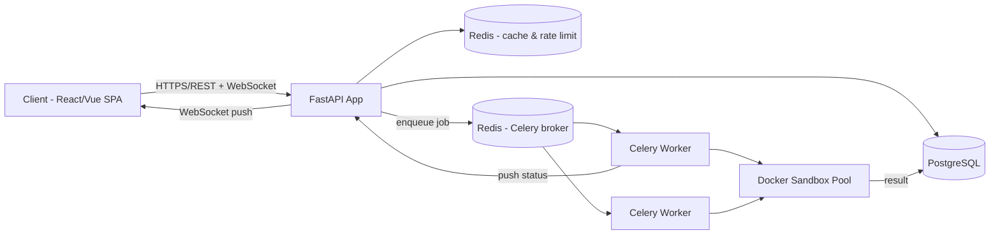

**Medicode — Backend Architecture & API Design Document**

**Project:** Medicode (CodeTantra-inspired coding practice & assessment platform) **Backend framework:** FastAPI (Python) **Purpose of this document:** A revisable reference for the backend architecture — API design, data model, sandbox execution engine, auth, and infrastructure decisions, with the reasoning behind each choice and the alternatives considered.

**1\. What we're building**

Medicode is a learning/assessment platform where instructors create courses made of problems (coding exercises), and students write and submit code that is automatically compiled/run against hidden and visible test cases, graded, and scored — similar to CodeTantra, HackerRank, or Judge0-based judges.

Three things make this different from a normal CRUD app:

1. **Untrusted code must be executed safely** — this is the core technical challenge.
2. **Grading is asynchronous** — a submission can't be graded inside the HTTP request/response cycle.
3. **Access control is role-based** — students, instructors, and admins see different things.

**1.1 Development Phases (small goals, easy targets)**

We build Medicode in small phases. Each phase has one focused goal and one easy, checkable target, and only builds on what the previous phase already delivered — so nothing is started until the foundation under it works. Every section below carries a phase tag so it is clear when that part gets built.

| **Phase**                           | **Goal (kept small)**                                                           | **Easy target — we are done when…**                                                                                         | **Sections**      |
| ----------------------------------- | ------------------------------------------------------------------------------- | --------------------------------------------------------------------------------------------------------------------------- | ----------------- |
| **Phase 1 — Foundation & Auth**     | A running FastAPI app where people can sign up, log in and have a role.         | Register, login and /auth/me work; a student token gets 403 on an instructor-only route; /docs opens.                       | 3, 5, 6.1, 6.2, 9 |
| **Phase 2 — Course Content**        | Instructors build courses, modules and problems; students enroll and view them. | An instructor creates a course with one problem and its test cases; a student enrolls and sees only the visible test cases. | 6.3               |
| **Phase 3 — Submit & Grade**        | Grade one language (Python) end to end using the queue and Docker sandbox.      | A student submits Python code, gets a submission_id instantly, and GET /submissions/{id} returns a score after grading.     | 2, 6.4, 6.6, 7, 8 |
| **Phase 4 — Real-time & Hardening** | Add live updates, community features and tighten security.                      | Result is pushed over WebSocket; leaderboard and discussions work; the security checklist is ticked off.                    | 6.5, 11, 12       |
| **After Phase 4**                   | Nice-to-haves only if time allows.                                              | Not required for v1.                                                                                                        | 13                |

**2\. High-Level Architecture**

**Built up in stages —** _Phase 1 needs only the FastAPI app and PostgreSQL. Phase 3 adds Redis, Celery workers and the Docker sandbox. Phase 4 adds WebSocket push. Do not set up the later pieces early._



**Components:**

| **Component**       | **Role**                                                                                               |
| ------------------- | ------------------------------------------------------------------------------------------------------ |
| FastAPI app         | Handles all REST/WebSocket traffic, auth, validation, business logic that doesn't involve running code |
| PostgreSQL          | System of record — users, courses, problems, submissions, results                                      |
| Redis               | Celery message broker, response cache, rate-limit counters                                             |
| Celery workers      | Pull submission jobs off the queue, orchestrate sandbox execution                                      |
| Docker sandbox pool | Isolated, resource-limited containers that actually run student code                                   |

**Why decouple execution from the API process at all?** If you run student code inside the FastAPI request handler, a single infinite loop, memory bomb, or fork bomb from one student can degrade or crash the whole API for everyone. Queuing the job means: the API stays responsive under load, execution can be retried/scaled independently, and you get natural backpressure during exam-time submission spikes (hundreds of students submitting within a few minutes).

**3\. Why FastAPI (and why not the alternatives)**

**Phase 1 —** _framework choice is made once, at project setup._

| **Criterion**                               | **FastAPI**                  | **Django + DRF**                    | **Flask**             | **Node/Express**                    |
| ------------------------------------------- | ---------------------------- | ----------------------------------- | --------------------- | ----------------------------------- |
| Async native                                | Yes (ASGI/Uvicorn)           | Bolted on, sync-first core          | No (needs extensions) | Yes                                 |
| Request/response validation                 | Built-in (Pydantic)          | Serializers (more boilerplate)      | Manual / extensions   | Manual (Zod/Joi)                    |
| Auto-generated API docs                     | Yes (OpenAPI/Swagger, Redoc) | Needs drf-yasg/spectacular          | Needs extension       | Needs extension                     |
| Dependency injection                        | Built-in (Depends)           | Not idiomatic                       | No                    | No                                  |
| Team language consistency with sandbox code | Same language (Python)       | Same                                | Same                  | Different (sandbox is still Python) |
| Learning curve for a student project        | Low–medium                   | Higher (lots of Django conventions) | Low                   | Medium                              |

**Reasoning:**

- Async support matters because most of your endpoints spend their time waiting on I/O (DB, Redis, polling job status), not doing CPU work — this is exactly what ASGI frameworks are built for.
- Pydantic schemas double as documentation and validation, so a malformed request is rejected before it ever touches your business logic or database.
- Auto-generated /docs (Swagger UI) means your frontend teammates always have an up-to-date contract without you maintaining a separate API spec.
- Django is a legitimate alternative, and its admin panel is genuinely useful for internal tooling (e.g., managing courses without building an admin UI) — worth considering as a _secondary_ internal-only service if you want a free admin panel, but not as the main API layer for this project.

**4\. Database Design (PostgreSQL)**

**Phase 1 → onward —** _Phase 1 only needs the users and refresh-token tables; each later phase adds the tables its own features need (details in the Database document)._

The full database design — the entity-relationship diagram and every table with its columns and constraints — is covered in a separate Database document. This document only assumes PostgreSQL as the database (accessed through SQLAlchemy, with schema changes managed by Alembic) and refers to tables such as users, courses, problems and submissions by name.

Why PostgreSQL: the data is highly relational (users, problems, submissions and per-test-case results) and grading needs transactional integrity, so a relational database is the natural fit.

**5\. Authentication & Authorization**

**Phase 1 —** _Easy target: register, login and a working role check first. Refresh-token rotation and revocation come last within this phase._

**Approach:** OAuth2 password flow + JWT access tokens + rotating refresh tokens, using FastAPI's built-in OAuth2PasswordBearer.

- **Password hashing:** argon2 (preferred) or bcrypt via passlib — never store plaintext, never use reversible encryption.
- **Access token:** short-lived JWT (e.g. 15 min), contains user_id and role, signed with a server secret.
- **Refresh token:** longer-lived, opaque, stored hashed in refresh_tokens table so it can be revoked (e.g., on logout or password change) — plain JWTs can't be individually revoked, which is why refresh tokens are stored server-side.
- **Why JWT over server-side sessions:** stateless verification (no DB hit to validate every request), scales horizontally across multiple API instances without sticky sessions or a shared session store — a natural fit for an SPA + potential mobile client.
- **RBAC:** a role field on users, enforced via FastAPI dependencies, e.g.:

```python
def require_role(*roles):
    def checker(user: User = Depends(get_current_user)):
        if user.role not in roles:
            raise HTTPException(403, "Not permitted")
        return user

    return checker


@router.post("/courses")
def create_course(data: CourseCreate, user=Depends(require_role("instructor", "admin"))): ...
```

This pattern keeps authorization logic out of the route body and composable across endpoints.

**6\. REST API Design**

Base path: /api/v1

**6.1 Auth**

**Phase 1 —** _all five endpoints._

| **Method** | **Path**       | **Notes**                      |
| ---------- | -------------- | ------------------------------ |
| POST       | /auth/register | student/instructor signup      |
| POST       | /auth/login    | returns access + refresh token |
| POST       | /auth/refresh  | rotate access token            |
| POST       | /auth/logout   | revokes refresh token          |
| GET        | /auth/me       | current user profile           |

**6.2 Users**

**Phase 1 —** _all three endpoints._

| **Method** | **Path**    | **Notes**             |
| ---------- | ----------- | --------------------- |
| GET        | /users/{id} | own profile or admin  |
| PATCH      | /users/{id} | update profile        |
| GET        | /users      | admin only, paginated |

**6.3 Courses / Modules / Problems**

**Phase 2 —** _Easy target: one instructor can create a course, module and problem; one student can enroll and view it._

| **Method** | **Path**               | **Notes**                                     |
| ---------- | ---------------------- | --------------------------------------------- |
| POST       | /courses               | instructor/admin                              |
| GET        | /courses               | list, paginated, filterable                   |
| GET        | /courses/{id}          | detail                                        |
| PUT        | /courses/{id}          | update                                        |
| DELETE     | /courses/{id}          | soft delete preferred                         |
| POST       | /courses/{id}/enroll   | student self-enroll or admin batch-enroll     |
| POST       | /courses/{id}/modules  | instructor                                    |
| POST       | /modules/{id}/problems | instructor                                    |
| GET        | /problems/{id}         | includes visible test cases only for students |

**6.4 Submissions (core flow)**

**Phase 3 —** _POST, GET /submissions/{id} and the history endpoint (polling). The WebSocket row is added in Phase 4._

| **Method** | **Path**                          | **Notes**                                                                                       |
| ---------- | --------------------------------- | ----------------------------------------------------------------------------------------------- |
| POST       | /submissions                      | body: {problem_id, code, language} → returns {submission_id, status: "pending"} **immediately** |
| GET        | /submissions/{id}                 | poll for status/result                                                                          |
| GET        | /submissions?user_id=&problem_id= | history                                                                                         |
| WS         | /ws/submissions/{id}              | real-time push when grading completes — avoids client having to poll aggressively               |

Example response once graded:

```json
{
  "submission_id": "b12e...",
  "status": "completed",
  "score": 80.0,
  "results": [
    {"test_case_id": 1, "passed": true, "execution_time_ms": 42},
    {"test_case_id": 2, "passed": false, "stderr": "IndexError: ..."}
  ]
}
```

**6.5 Leaderboard / Discussions / Admin**

**Phase 4 —** _start with the leaderboard, then discussions, then admin stats._

| **Method** | **Path**                   | **Notes**               |
| ---------- | -------------------------- | ----------------------- |
| GET        | /courses/{id}/leaderboard  | ranked by total score   |
| GET        | /problems/{id}/discussions | threaded doubts         |
| POST       | /problems/{id}/discussions | post a doubt/reply      |
| GET        | /admin/stats               | admin dashboard metrics |

**6.6 Internal-only (not exposed to the client)**

**Phase 3 —** _built together with the sandbox._

POST /internal/execute — called only by Celery workers to hand a job to the sandbox runner; never reachable from the public API surface (separate network/auth, or not an HTTP endpoint at all — can just be a Python function called in-process by the worker).

**7\. The Sandbox: Executing Untrusted Code Safely**

**Phase 3 —** _Small goal: Python only, one docker run per submission, exact-match grading. More languages, custom checkers and the warm pool come later (see 7.5 and Section 13)._

This is the part that actually differentiates Medicode from a plain CRUD app, so it deserves the most care.

**7.1 What we're defending against**

A student's submitted code could (intentionally or not):

- Read/write files on the host
- Open network connections (exfiltrate data, attack other services)
- Fork-bomb or allocate unbounded memory
- Run forever (infinite loop)
- Attempt to escape its isolation to affect other submissions or the host

**7.2 Options considered**

| **Approach**                                                               | **Isolation level**                                     | **Verdict**                                                                                                                                                                                  |
| -------------------------------------------------------------------------- | ------------------------------------------------------- | -------------------------------------------------------------------------------------------------------------------------------------------------------------------------------------------- |
| subprocess.run() + resource.setrlimit                                      | **None** — same kernel, same filesystem visibility      | OK for local prototyping only. **Do not use for real users.**                                                                                                                                |
| AST-restricted exec() (e.g. RestrictedPython)                              | Weak, Python-only, many documented escapes historically | Not sufficient as the sole defense                                                                                                                                                           |
| **Docker container per submission**                                        | Strong — kernel namespaces + cgroups                    | **Recommended for this project.** Industry-standard baseline isolation                                                                                                                       |
| gVisor / Firecracker microVMs                                              | Very strong — user-space kernel or hardware-virtualized | What Judge0 v1.13+ and AWS Lambda use; stronger than plain Docker but higher setup complexity — good as a **future hardening step**, not a v1 requirement                                    |
| Reuse an existing judge engine (**Judge0**, **Piston**) via their REST API | Strong, already built and maintained                    | Fastest path to a working grader; trades "we built the sandbox" for "we integrated a sandbox" — worth doing if the learning goal is the LMS/platform rather than the execution engine itself |

**Recommendation:** Build the sandbox on Docker containers, since that mirrors what real judges do and is achievable within a project scope, while keeping the interface between your Celery worker and the sandbox abstract enough that you could swap in Judge0/Piston later without touching the rest of the system.

**7.3 Container run configuration (example)**

```bash
docker run --rm \
  --network=none \
  --memory=256m --memory-swap=256m \
  --cpus=0.5 \
  --pids-limit=64 \
  --read-only \
  --tmpfs /tmp:rw,size=16m \
  -v /submissions/<id>:/code:ro \
  --user 1000:1000 \
  python:3.11-slim \
  timeout 5 python /code/main.py
```

Key flags and why each matters:

- \--network=none — no network access at all, prevents data exfiltration or attacking other services
- \--memory / --cpus / --pids-limit — hard resource ceilings, prevent fork bombs and memory exhaustion
- \--read-only + --tmpfs — the container filesystem can't be permanently modified
- \--user 1000:1000 — never run as root inside the container
- timeout 5 — hard wall-clock limit as a second layer on top of any in-language timeout

**7.4 End-to-end execution flow**

**Phase 3 —** _Easy target: complete steps 1–7 once for a single Python problem before adding anything else._

1. Client calls POST /submissions → row inserted with status=pending → submission_id returned **immediately** (the HTTP request never waits on execution).
2. FastAPI publishes a job to Redis (Celery broker).
3. A Celery worker picks up the job, writes the submitted code to a temp volume, and runs (or reuses, see §7.5) a Docker container with the config above, piping in each test case's input.
4. The worker captures stdout, stderr, exit code, wall-clock time, and peak memory; kills the container on timeout.
5. Output is compared against expected_output per test case (exact match by default; a "custom checker" script can be substituted for problems with multiple valid outputs, e.g. floating-point tolerance).
6. submission_results rows are inserted, submissions.status set to completed, score computed.
7. Result is pushed to the client over the WebSocket (or picked up on the next poll of GET /submissions/{id}).

**7.5 Performance note: container startup latency**

**After Phase 3 —** _optimize only after the basic flow works and latency has been measured._

Starting a fresh Docker container per submission has noticeable overhead (hundreds of ms). At scale, mitigate with:

- A **warm pool** of pre-started, idle containers that get a fresh code mount per job and are recycled after use
- Or **language-specific persistent workers** with a strict per-job chroot/namespace reset

For a first version, plain docker run per submission is simpler to reason about and secure; optimize only once you've measured actual latency under load.

**8\. Data Structures (Pydantic + SQLAlchemy)**

**Phase 3 —** _these contracts are needed once submissions exist. Start with language set to python only; add cpp and java later._

**Pydantic (API contracts):**

```python
class SubmissionCreate(BaseModel):
    problem_id: int
    code: str
    language: Literal["python", "cpp", "java"]


class SubmissionResultOut(BaseModel):
    test_case_id: int
    passed: bool
    execution_time_ms: int
    stderr: str | None = None


class SubmissionOut(BaseModel):
    id: UUID
    status: Literal["pending", "running", "completed", "error"]
    score: float | None
    results: list[SubmissionResultOut] = []
```

**SQLAlchemy (persistence + FK relationships):**

```python
class Submission(Base):
    __tablename__ = "submissions"

    id = Column(UUID, primary_key=True, default=uuid4)
    user_id = Column(ForeignKey("users.id"), nullable=False)
    problem_id = Column(ForeignKey("problems.id"), nullable=False)
    code = Column(Text, nullable=False)
    status = Column(Enum(SubmissionStatus), default=SubmissionStatus.pending)
    score = Column(Float, nullable=True)

    results = relationship("SubmissionResult", back_populates="submission")
    user = relationship("User")
    problem = relationship("Problem")
```

**Schema migrations:** managed with **Alembic**, so schema changes are version-controlled and reversible rather than applied by hand — essential once more than one person is touching the database.

**9\. Suggested Project Structure**

**Grows phase by phase —** _Phase 1: core/, db/, models/, schemas/, routers/auth.py. Phase 2: course, module and problem routers plus services/. Phase 3: workers/ and sandbox/. Phase 4: WebSocket handler and extra routers._

```text
medicode-backend/
├── app/
│ ├── main.py # FastAPI app instantiation, router includes
│ ├── core/
│ │ ├── config.py # settings (pydantic-settings, env vars)
│ │ └── security.py # password hashing, JWT encode/decode
│ ├── db/
│ │ ├── session.py # SQLAlchemy engine/session
│ │ └── base.py
│ ├── models/ # SQLAlchemy ORM models
│ ├── schemas/ # Pydantic request/response models
│ ├── routers/ # one file per resource: auth.py, courses.py, submissions.py ...
│ ├── services/ # business logic (grading, scoring, enrollment rules)
│ ├── workers/ # Celery app + tasks
│ ├── sandbox/ # Docker execution logic, resource limits
│ └── tests/
├── alembic/ # migrations
├── docker-compose.yml # api + postgres + redis + worker services
└── requirements.txt
```

**10\. Tech Stack Decision Summary**

**Introduced gradually —** _FastAPI, PostgreSQL and SQLAlchemy/Alembic in Phase 1; Celery, Redis and Docker in Phase 3; WebSocket in Phase 4._

| **Layer**         | **Chosen**                             | **Alternatives considered**                                         | **Why chosen**                                                                                                                             |
| ----------------- | -------------------------------------- | ------------------------------------------------------------------- | ------------------------------------------------------------------------------------------------------------------------------------------ |
| API framework     | FastAPI                                | Django+DRF, Flask, Express                                          | Async native, built-in validation & docs, dependency injection                                                                             |
| Database          | PostgreSQL                             | MySQL, MongoDB                                                      | Relational integrity for grading, JSONB flexibility, strong tooling                                                                        |
| ORM/migrations    | SQLAlchemy + Alembic                   | Tortoise ORM, raw SQL                                               | Mature, explicit, version-controlled schema                                                                                                |
| Task queue        | Celery + Redis                         | RQ, FastAPI BackgroundTasks                                         | BackgroundTasks doesn't survive process restarts or scale across machines; Celery is the standard for durable, retryable, distributed jobs |
| Sandbox           | Docker (per-submission containers)     | raw subprocess, RestrictedPython, gVisor/Firecracker, Judge0/Piston | Strong isolation achievable within project scope; upgrade path to microVMs or an external judge later                                      |
| Auth              | JWT (access) + rotating refresh tokens | Server-side sessions                                                | Stateless, horizontally scalable, revocable via refresh-token table                                                                        |
| Real-time updates | WebSocket                              | Long polling only                                                   | Avoids aggressive polling load during exam-time bursts                                                                                     |

**11\. Security Checklist**

**Phase 4 (basics earlier) —** _Password hashing and JWT expiry are done in Phase 1, hidden-test-case filtering in Phase 2, sandbox limits in Phase 3. Phase 4 finishes the rest of the checklist._

- \[ \] Sandbox containers: no network, read-only filesystem, non-root user, CPU/memory/PID limits, wall-clock timeout
- \[ \] Rate-limit submission endpoint per user (Redis-backed) to prevent grading-queue flooding
- \[ \] CORS restricted to known frontend origins
- \[ \] All traffic over HTTPS in production
- \[ \] Passwords hashed with argon2/bcrypt, never logged
- \[ \] SQL injection prevented structurally by using the ORM (no raw string-interpolated queries)
- \[ \] JWT access tokens short-lived; refresh tokens stored hashed and revocable
- \[ \] Audit log of admin/instructor actions (grade overrides, deletions)
- \[ \] Input validation on every endpoint via Pydantic (rejects malformed payloads before they reach business logic)

**11.1 Preventing Client-Side Tampering & Cheating (Console / DevTools)**

**The core principle: assume the browser is hostile.** Anything running in the student's browser — including your own frontend JavaScript — is fully under the student's control. They can open DevTools, read the Network tab, replay requests with modified bodies, or call your API directly with curl/Postman/console fetch(), completely bypassing your frontend UI. This means **the only real security boundary is what the server enforces on every request, not what the frontend hides.** With that principle in mind:

- **Never trust client-supplied grading data.** A submission's score, status, and passed flags must be computed and written by the server/worker only. The SubmissionCreate schema accepts only problem_id, code, and language — there is no field a client can set to influence its own result, by design (see §8).
- **Never leak hidden test cases in any API response**, including responses to the student's own submissions. Filter is_hidden=True test case input/expected_output out server-side, based on the authenticated user's role, before serialization — not via frontend logic, since the raw response is always visible in the Network tab regardless of what the UI renders.
- **Submissions are immutable once created.** There is no PATCH/PUT endpoint on submissions.code or on submission_results. A student "editing and resubmitting" always creates a _new_ submission row, preserving an audit trail of exactly what code produced which result — this closes the "submit, see the hidden result, quietly edit the code, then claim credit" gap.
- **Hiding endpoints from documentation is not a security control.** Disabling /docs and /redoc in production (or gating them behind admin auth) is reasonable hygiene so casual users don't browse your API surface, but a motivated student can still discover routes from your frontend's own Network tab traffic. Every endpoint — documented or not — must independently enforce authentication + role authorization + field validation, as if its URL were already public.
- **Internal-only routes (e.g. the sandbox execution trigger) must be unreachable from the public internet**, not merely omitted from docs — put them on a private network/internal service mesh, or require service-to-service auth (an internal API key or mTLS) that a browser can never present.
- **Disabling right-click / DevTools in the frontend is, at best, a mild deterrent — not a security measure.** DevTools blocking is trivially bypassable (disabling JS, using browser extensions, or just hitting the API directly with a separate tool), so don't let it substitute for server-side checks above. It can still be worth adding during proctored exams purely to discourage casual copy-pasting, as long as it's understood to add friction, not real protection.
- **Rate-limit and monitor the submissions endpoint** for anomalous patterns (e.g., dozens of submissions to the same problem within seconds) that could indicate scripted probing for hidden test case outputs rather than genuine attempts.
- **Log the raw request/response for grading-related endpoints** so any attempted exploit can be reviewed after the fact and the corresponding gap closed — treat this as an ongoing process, not a one-time checklist.

**12\. Scalability & Deployment Notes**

**After Phase 4 —** _only scale when real load needs it; docker-compose is enough until then._

- Run multiple Uvicorn worker processes behind a reverse proxy (Nginx) for the API tier.
- Celery workers scale independently of the API — add more workers during exam windows, scale down otherwise.
- Redis serves double duty as cache + broker in early stages; split into separate instances if either becomes a bottleneck.
- Postgres read replicas can offload leaderboard/reporting queries from the primary write path once traffic grows.
- docker-compose is sufficient for development and small deployments; Kubernetes is a reasonable future step if you need auto-scaling worker pools, but is not necessary for a first version.

**13\. Future Enhancements (out of scope for v1)**

**After Phase 4 —** _none of these are needed for v1._

- Multi-language support beyond Python (C++, Java)
- Plagiarism detection (MOSS-style token similarity between submissions)
- Advanced video/webcam continuous proctoring (basic telemetry tab-switch & subnet lock are active in V1)
- Advanced analytics dashboard for instructors (per-problem difficulty stats, common error patterns)
- Stronger sandbox isolation via gVisor/Firecracker microVMs
- Mobile native client app

**14\. Summary**

**Phase order —** _1 Foundation & Auth → 2 Course Content → 3 Submit & Grade → 4 Real-time & Hardening._

The system is built around one central principle: **the API layer never executes untrusted code directly.** Everything else — the queue, the worker pool, the container isolation, the WebSocket push — exists to serve that one constraint safely and at scale. Start with the Docker-per-submission approach for the sandbox, PostgreSQL for the data model above, and JWT-based auth with RBAC, and the rest of the platform (courses, enrollments, leaderboards, discussions) is comparatively standard CRUD work on top of that foundation.

---

### Some Changes by Ayush

## 15. Server-Side Security Architecture & Hardening Specifications

To prevent client-side anti-cheat bypasses and protect the platform against malicious exploits during live lab exams, the backend implements mandatory server-side security controls:

### 15.1 Subnet / IP CIDR Hard Enforcement Middleware
- **Mechanism**: Nginx reverse-proxy extracts client remote IP (`X-Forwarded-For`).
- **Enforcement**: Middleware matches client IP against the course's `allowed_subnet_cidr` (e.g. `172.16.4.0/24`). Requests outside physical lab IP bounds are rejected with `HTTP 403 Forbidden`.

### 15.2 Mandatory Redis `jti` Active Session Tracking
- **Mechanism**: Every JWT access token includes a unique `jti` (JWT ID) claim.
- **Enforcement**: Middleware checks `Redis GET active_session:{user_id} == jti` on every protected request. Login on a second device overwrites the `jti` in Redis, instantly revoking the previous session server-side.

### 15.3 Server-Side Anti-Replay HMAC Telemetry Verification
- **Mechanism**: Anti-cheat events (tab switch, window blur, decibel audio spikes) are signed client-side with an ephemeral session HMAC key.
- **Enforcement**: Backend verifies payload signature and sequence numbers before storing telemetry in PostgreSQL/Redis PubSub to prevent fake telemetry injection via Curl/Postman.

### 15.4 Redis Token-Bucket Rate Limiting
- **`POST /submissions`**: Max 1 execution request every 4 seconds per student ID (`429 Too Many Requests`).
- **`POST /auth/login`**: Max 5 failed attempts per 15 minutes per IP before temporal account lock.
- **`POST /ai/socratic-hint`**: Max 15 hint requests per student per lab session.

### 15.5 Server-Side Test Case Isolation & Timing Delay Masking
- Hidden test case `input_data` and `expected_output` are filtered out server-side for non-instructor roles.
- Individual execution times for hidden test cases are aggregated/masked to prevent timing side-channel attacks (`time.sleep` probing).

### 15.6 AI Mentor Socratic Output Sanitizer
- Post-execution regex and AST parser sanitizes all LLM responses before returning them to the client.
- Any detected code block (` ```python ` or `def solve():`) is forcefully stripped to enforce Socratic hint rules.

### 15.7 Hardened Sandbox Container Limits (nsjail / gVisor + cgroups v2)
- `--cap-drop=ALL` (drops all Linux kernel capabilities).
- `--net=none` (complete network isolation; blocks SSRF and metadata endpoints).
- `pids.max = 32` (blocks fork bombs and process starvation).
- Hard CPU wall-clock limit (2.0s) & RAM limit (128MB).
- Read-only rootfs with RAM-backed `/tmp` tmpfs (16MB max).